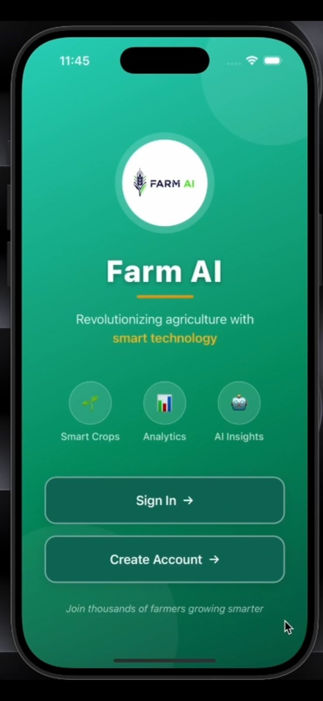
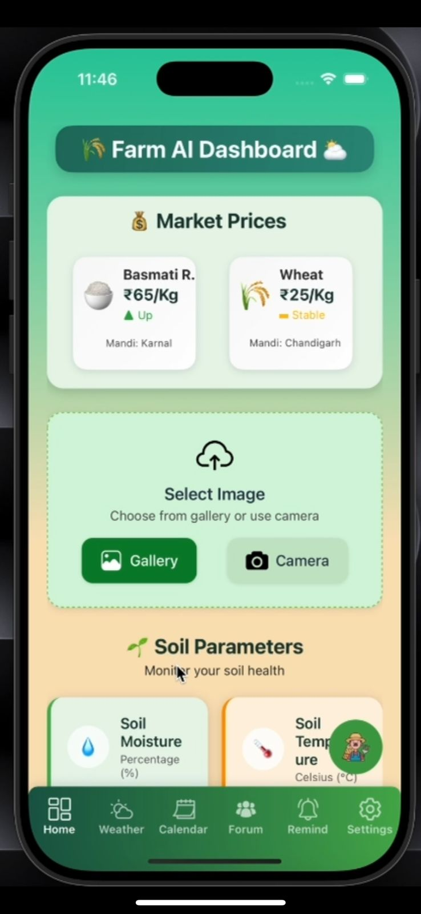
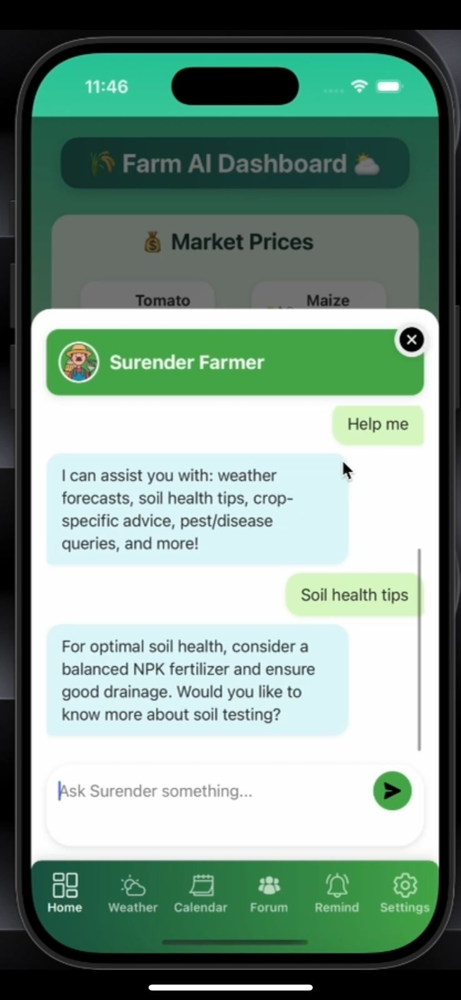
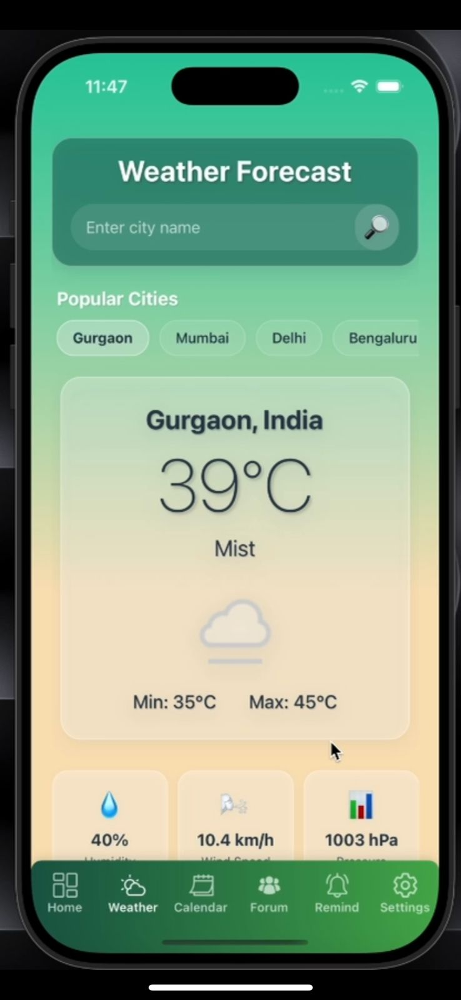
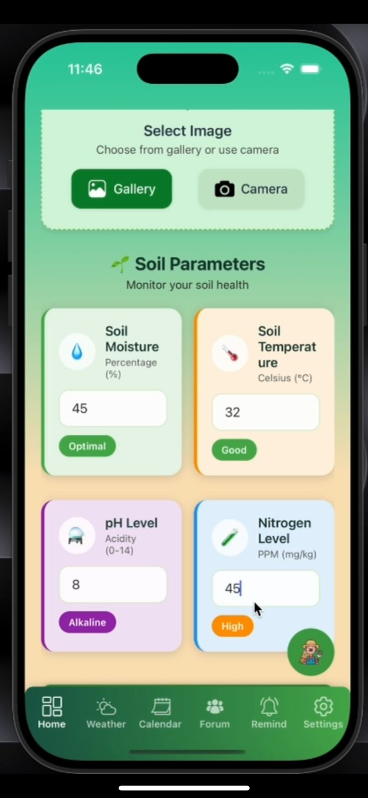
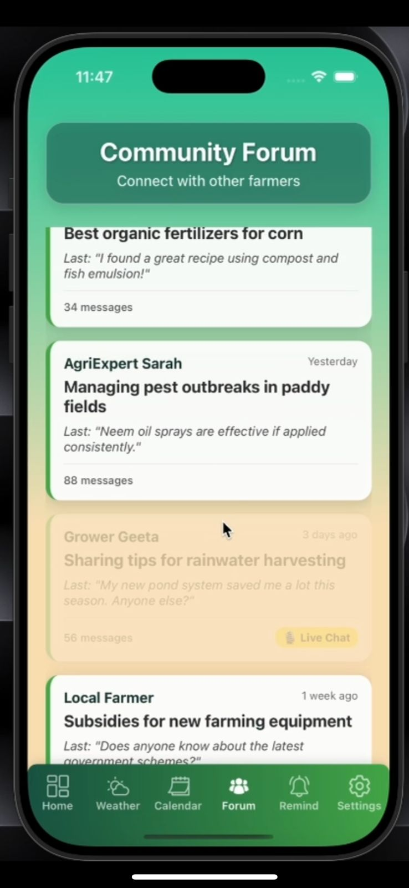
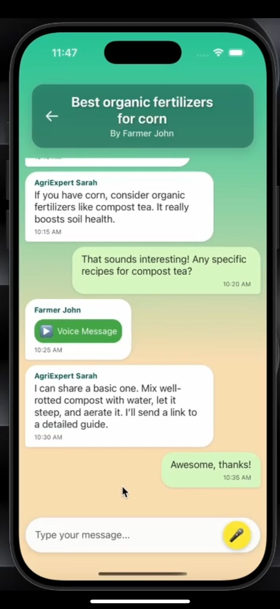
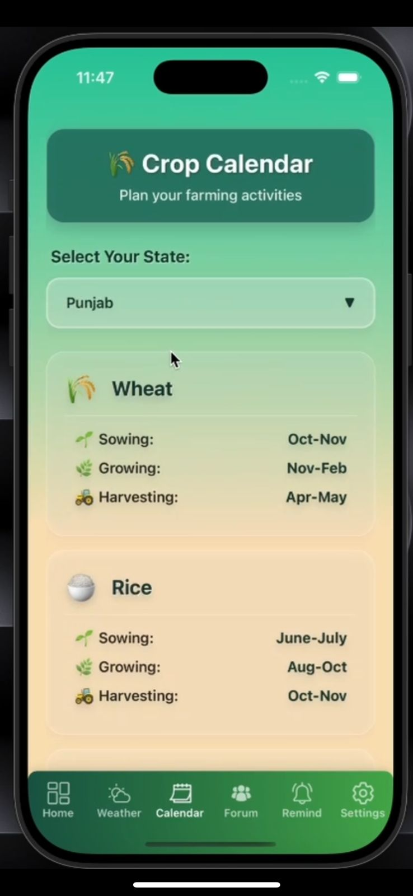
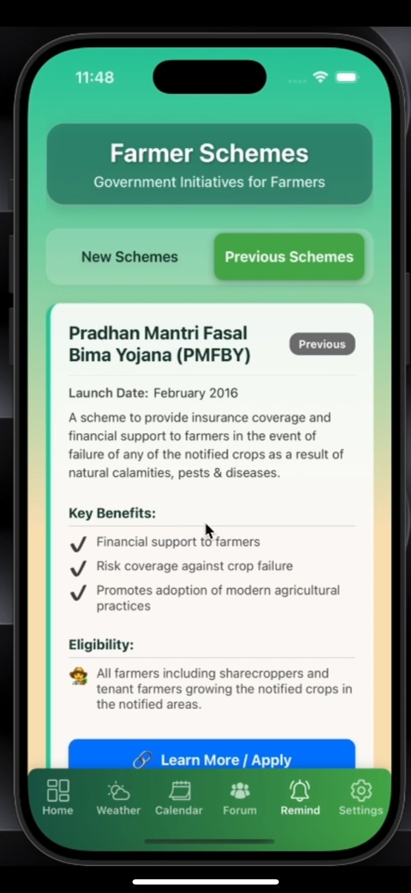
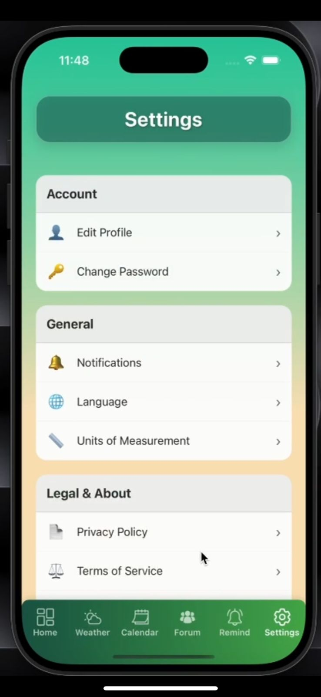

# 🌱 FarmAI — AI-Powered Smart Agriculture Platform

FarmAI is a smart agriculture project combining a React Native mobile application with machine learning, deep learning, and computer vision techniques for crop disease classification and agricultural assistance.

The mobile application provides farming-related features such as weather information, crop calendars, reminders, and community interactions. The ML component explores image-based disease classification for eight crops: Apple, Banana, Cotton, Grapes, Mango, Rice, Sugarcane, and Wheat.

**My primary role was in Machine Learning, Deep Learning, and Computer Vision**, focusing on image preprocessing, crop-specific model experimentation, classification, and model evaluation.

## 📱 Application Screenshots

### 1. Application Overview



### 2. Application Interface


### 3. Application Features





### 4. Additional Screens















## 🚀 Key Features

- Crop leaf disease classification experiments across eight crops.
- Crop-specific deep learning architectures.
- Image preprocessing and automatic feature extraction.
- Transfer learning with pretrained architectures where applicable.
- Classification performance evaluation.
- Mobile screens for farming assistance, weather, crop calendars, reminders, and community interactions.
- Comparison of traditional machine learning classifiers using CNN-generated image representations for grape disease classification.

## 🌾 Crops and Models

| Crop | Model / Architecture |
|---|---|
| Apple | Xception |
| Banana | Vision Transformer (ViT-B/16) |
| Cotton | Custom CNN |
| Grapes | CNN features + traditional ML classifiers |
| Mango | VGG16 |
| Rice | Xception |
| Sugarcane | ResNet50 |
| Wheat | Custom CNN |

## 👨‍💻 My Role: Machine Learning & Deep Learning

My primary contribution focused on the machine learning and deep learning components of FarmAI.

### Dataset Preparation and Preprocessing

- Worked with labeled crop leaf image datasets.
- Prepared images for model training and evaluation.
- Applied image resizing and normalization according to model requirements.
- Organized data by crop and disease category.
- Prepared training, validation, and testing splits where applicable.

### Model Development

Experimented with different architectures for crop-specific classification tasks:

- Xception for apple and rice.
- Vision Transformer (ViT-B/16) for banana.
- Custom CNNs for cotton and wheat.
- VGG16 for mango.
- ResNet50 for sugarcane.
- CNN feature extraction with Decision Tree, Random Forest, XGBoost, and KNN for grape disease classification experiments.

### Model Evaluation

Used appropriate classification metrics where available:

- Accuracy
- Precision
- Recall
- F1-score
- Confusion matrix
- Validation loss

These metrics help assess overall performance, class-specific errors, and potential overfitting.

### Recorded Grape Classification Results

The grape classification notebook recorded the following accuracy values:

| Model | Reported Accuracy |
|---|---:|
| CNN | 98.27% |
| Decision Tree | 98.13% |
| Random Forest | 98.34% |
| XGBoost | 97.99% |
| KNN | 98.48% |

These results represent the recorded experiment and its evaluation setup; they do not guarantee equivalent performance on real-world field images.

## 🔄 Machine Learning Workflow

1. Collect labeled crop leaf images.
2. Explore image categories and dataset quality.
3. Preprocess images through resizing and normalization.
4. Split the dataset into training, validation, and testing sets where applicable.
5. Select an appropriate model architecture.
6. Train or fine-tune the model.
7. Generate predictions for input images.
8. Evaluate predictions using classification metrics.
9. Compare alternative models where applicable.
10. Make predictions available to the application through the implemented inference workflow, where integration is present.

## 🛠️ Technology Stack

### Machine Learning and Computer Vision

- Python
- TensorFlow / Keras
- PyTorch
- Scikit-learn
- XGBoost
- OpenCV
- NumPy
- Pandas
- Matplotlib
- Seaborn
- Jupyter Notebook

### Mobile Application

- React Native
- TypeScript
- JavaScript
- Android and iOS development tools

The specific libraries used depend on the individual model experiments and application modules.

## 📂 Project Structure

```text
Farm_AI/
├── android/
├── ios/
├── assets/
├── components/
├── screens/
├── screenshots/
│   ├── 1.jpeg
│   ├── 2.jpeg
│   ├── 3.jpeg
│   ├── 4.jpeg
│   ├── 5.jpeg
│   ├── 6.jpeg
│   ├── 7.jpeg
│   ├── 8.jpeg
│   ├── 9.jpeg
│   ├── 10.jpeg
│   └── 11.jpeg
├── App.tsx
├── app.json
├── package.json
├── package-lock.json
└── README.md
```

## ⚙️ Getting Started

### Prerequisites

- Node.js and npm
- Android Studio and an Android emulator or connected Android device
- React Native development environment
- Xcode and CocoaPods for iOS development on macOS

### 1. Clone the repository

```bash
git clone <YOUR_REPOSITORY_URL>
cd Farm_AI
```

Replace the placeholder with your repository's actual clone URL.

### 2. Install dependencies

```bash
npm install
```

### 3. Start Metro

```bash
npm start
```

### 4. Run on Android

Open a second terminal in the project root and execute:

```bash
npm run android
```

For iOS on macOS, follow the project's CocoaPods setup instructions and run:

```bash
npm run ios
```

For environment setup, refer to the [official React Native documentation](https://reactnative.dev/docs/set-up-your-environment).

## ⚠️ Limitations

- Classification performance depends on dataset quality, labels, and image conditions.
- Performance on curated images may differ from real-world farm photographs.
- Models can only classify categories represented in their training data.
- Availability of model inference in the mobile application depends on the implemented integration.
- Predictions should be treated as an initial screening aid, not a definitive agricultural diagnosis.

## 🔮 Future Scope

- Integrate trained models through a documented API or on-device inference.
- Improve robustness using diverse real-world crop images.
- Add explainability techniques such as Grad-CAM where appropriate.
- Expand crop and disease coverage.
- Provide expert-reviewed disease management guidance.
- Evaluate models on independent field datasets.

## 🎯 Project Objective

FarmAI explores the use of machine learning, deep learning, computer vision, and mobile application development to support crop disease identification and agricultural assistance.

## 👨‍💻 Contribution

**Primary focus:** Machine Learning, Deep Learning, and Computer Vision.

Key areas include image preprocessing, crop-specific model experimentation, image classification, traditional ML model comparison, and performance evaluation.

## 📄 License

Before distributing the project, select an appropriate open-source license and verify the licensing requirements of any third-party datasets, libraries, and pretrained model weights.
